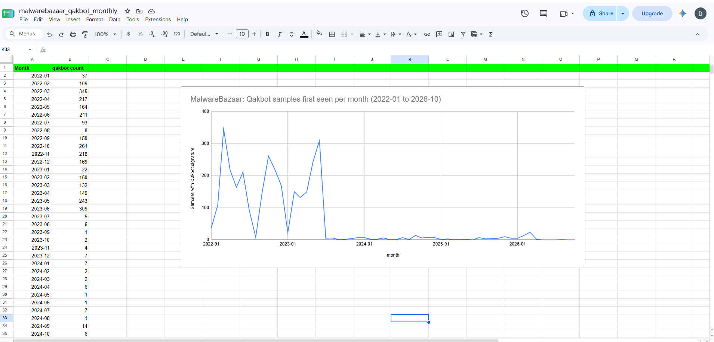

# Did the 2023 takedown reduce Qakbot activity? An intelligence assessment from public data

**Author:** Adebisi Damilola Abiola | **Date:** October 2026 | **Marking:** TLP:CLEAR (public sources only)
**Data snapshot:** MalwareBazaar full dump, last updated 2026-10-14 09:35 UTC | **ATT&CK version:** v20
**Audience:** SOC team at a regional bank (hypothetical audience for a portfolio project)

---

## 1. Bottom line

I assess with **low to moderate confidence** that Qakbot's visible activity was already falling before the takedown in late August 2023 (announced by the DOJ on 29 August), so the takedown probably did not start the decline. The sharp fall in MalwareBazaar samples began in July 2023, and Zscaler reported a similar drop after June. The takedown may have helped keep activity low afterwards.

The SOC should lower the priority of Qakbot-specific indicators but keep behaviour-based detections for phishing attachments and links, scripted downloads and DLL side-loading, because the operators appear to have stayed active with other tools.

**Confidence is low to moderate** because the main evidence is one dataset, and the data cannot separate less Qakbot activity from fewer people reporting it.

---

## 2. Intelligence requirements

| Item | Content |
|---|---|
| **Audience** | SOC team at a regional branch of a bank (hypothetical) |
| **Decision question** | Should our SOC keep Qakbot detection as a high priority, or lower its priority? |
| **Main question** | Qakbot samples on MalwareBazaar went down drastically from mid-2023. Was the August 2023 takedown part of the reason, and what else could explain it? |
| **Working hypothesis** | The takedown contributed to the drop in Qakbot samples. |

**Alternative explanations to test:** the drop began in July, before the takedown; Qakbot usually slows in summer; researchers may have changed how they submit samples.

**Sub-questions**
1. Did the drop start before or after the takedown? (answered by the monthly data)
2. Do independent sources report Qakbot activity after August 2023?
3. What other reasons do those sources give for the change?

*Seasonality note:* the summer-lull explanation was tested through evidence E6 below. Earlier dips (August 2022, January 2023) recovered within a month and the 2023 drop did not, but only one earlier summer is available, so this is a hypothesis and not a finding.

**Intelligence cycle used:** direction (this section) → collection (sections 3 and 4) → processing (scripts) → analysis (sections 4 to 7) → dissemination (`executive_brief.md`). No stakeholder feedback stage was possible, because the audience is hypothetical.

---

## 3. Sources and evaluation

Full register with key facts in [`analysis/source_register.csv`](analysis/source_register.csv).

| ID | Source | Date | Type | Independence |
|---|---|---|---|---|
| S01 | DOJ press release, *Qakbot Malware Disrupted in International Cyber Takedown* | 2023-08-29 | Primary | Original. Figures are the authorities' own claims. |
| S02 | Cisco Talos, *Qakbot-affiliated actors distribute Ransom Knight malware despite infrastructure takedown* | 2023-10-05 | Primary | Original. Judgments at moderate confidence. |
| S03 | Zscaler ThreatLabz, *Hibernating Qakbot* | 2023-07-25 | Primary | Original, Zscaler's own telemetry. Published before the takedown. |
| S04 | Microsoft Threat Intelligence, posts on X | 2023-12-16 (as displayed; SC Media says 15 Dec) | Primary | Original. One vendor's telemetry. |
| S05 | SC Media, *New QakBot phishing campaign appears, months after FBI takedown* | 2023-12-18 | Secondary | **Repeats S04** (and S02). Not counted as confirmation. |
| S06 | MITRE ATT&CK, QakBot (S0650) | last modified 2024-11-17 | Secondary (reference) | Used for technique names only. |

**Avoiding double-counting.** Several news outlets repeat Microsoft's X post. They trace back to one original source, so the December 2023 resurgence counts as one piece of evidence, not several.

**Decision log: a second dataset was not possible.** I planned to cross-check MalwareBazaar against URLhaus and ThreatFox. URLhaus bulk dumps cover only active URLs or the last 90 days (`evidence/urlhaus_export_limitations.png`), and ThreatFox expires IOCs older than 6 months and does not expose them on its API or exports (`evidence/threatfox_export_limitations.png`, `evidence/threatfox_api_limitations.png`). Neither can support a 2022 to 2026 trend. I kept MalwareBazaar as the single long-term dataset and cross-checked it against independent vendor reporting instead. This is why the confidence is capped at low to moderate.

---

## 4. Data analysis

**Method.** I downloaded MalwareBazaar's full CSV dump (`full.csv.zip`, last updated 2026-10-14 09:35 UTC, covering 2020-01-10 to 2026-10-14, about 1.15 million rows). Qakbot was identified from the `signature` column. The dump has no tags column, so this is a limitation. The spellings found were `Quakbot` (64,187 rows) and `QuakBot` (3,660 rows). Scripts are in [`scripts/`](scripts/) and results in [`data/`](data/).

| | Before (2022-01 to 2023-06) | After (2023-09 to 2026-09) |
|---|---|---|
| Average Qakbot samples per month | about 166 | about 4 |
| Qakbot share of all submissions | about 1.3% | about 0.04% |
| Average total submissions per month | about 13,800 | about 12,000 |
| Average distinct Qakbot reporters per month | about 18 | about 1.6 |

2023-08 is excluded as the takedown month, and 2026-10 is a partial month (snapshot taken on 14 October).

**Controls.** I added two controls so that I did not read too much into one number:
1. **Total submissions.** They stayed in the thousands every month, so the drop is specific to Qakbot, not a platform-wide change. (Early 2024 was weaker for the whole platform, at about 7,400 a month against about 12,000 in the first half of 2023. It recovered, and Qakbot did not.)
2. **Distinct reporters.** They fell sharply, which is a limit on what the data can prove (see section 7).

**Fact, judgment, gap**
- **Fact:** Qakbot's share of MalwareBazaar submissions fell from about 1.3% to about 0.04% while total submissions stayed in a similar range.
- **Judgment (low to moderate confidence):** the drop reflects a real change in how visible Qakbot was, because it affected only Qakbot. It began in July 2023, before the takedown, so the takedown did not start it, though it may have helped keep activity low afterwards.
- **Gap:** I cannot tell whether Qakbot activity really fell or fewer researchers were reporting it. I also cannot rule out samples being submitted under a different name.

---

## 5. Evidence

1. In the MalwareBazaar full dump (snapshot 14 October 2026), Qakbot samples averaged about 166 a month from January 2022 to June 2023 and about 4 a month from September 2023 to September 2026. [Phase 3 data]
2. Samples fell from 309 in June 2023 to 5 in July 2023, before the takedown. [Phase 3 data]
3. Qakbot's share of all MalwareBazaar submissions fell from about 1.3% to about 0.04%, while total monthly submissions stayed in a similar range (roughly 13,800 before and 12,000 after). [Phase 3 data]
4. Distinct reporters of Qakbot samples fell from about 18 a month to about 1.6, so fewer people were reporting it. [Phase 3 data]
5. Zscaler reported on 25 July 2023, a month before the takedown, a significant drop in Qakbot activity after June, and said the reasons were unclear. [S03]
6. Cisco Talos reported on 5 October 2023 that a phishing campaign delivering Ransom Knight ransomware and the Remcos backdoor began in early August, before the takedown, and continued after it. Talos assessed with moderate confidence that Qakbot affiliates were behind it, and said it had not seen Qakbot itself distributed after the takedown. [S02]
7. Microsoft Threat Intelligence reported on 16 December 2023 (as displayed in my browser's time zone) a low-volume Qakbot phishing campaign that began on 11 December and targeted the hospitality industry. [S04]

**The takedown, for context:** the DOJ announced it on 29 August 2023 and claimed the FBI identified over 700,000 infected computers. That figure is the authorities' own claim and was not independently measured. [S01]

---

## 6. Behaviour and MITRE ATT&CK mapping

Full table in [`analysis/attack_mapping.csv`](analysis/attack_mapping.csv). **Rule:** a technique is mapped only when one of S01 to S04 describes the behaviour. S06 (MITRE's software page) is used for names and IDs only, because it shows what Qakbot has been known to do, not what happened in these campaigns.

| Technique | Behaviour | Source | Period | Stated or inferred |
|---|---|---|---|---|
| T1566.001 Spearphishing Attachment | Spam emails with malicious attachments | S01 | Before takedown | Inferred (parent T1566 stated in S03) |
| T1566.002 Spearphishing Link | Spam emails with malicious links | S01 | Before takedown | Inferred |
| T1566.001 and T1566.002 | Email with PDF attachment containing a link that downloaded a signed installer | S04 | Dec 2023 | Inferred |
| T1105 Ingress Tool Transfer | LNK files running PowerShell to fetch a file from a remote share | S02 | Aug 2023 | Stated by Talos |
| T1053.005 Scheduled Task | XLL chain created scheduled tasks every 10 minutes | S03 | Mar 2023 | Listed in S03; behaviour matched by me |
| T1202 Indirect Command Execution | conhost.exe used as a proxy | S03 | May 2023 | Listed in S03; behaviour matched by me |
| T1574.001 Hijack Execution Flow: DLL | DLL side-loading | S03 | May 2023 | Listed in S03 (as T1574.002); behaviour matched by me |

**Notes**
- I first considered T1598 (Phishing for Information) and rejected it. It is a Reconnaissance technique aimed at gathering information, while these emails deliver malware.
- Tactic names are copied from the v20 pages. S03 (2023) used older names, for example Defense Evasion where v20 shows Stealth.
- S03 cites T1574.002. The v20 page for T1574.001 has a DLL Sideloading section and T1574.002 is not listed, which is consistent with a merge but not confirmed.
- Seven of eight rows describe behaviour before the takedown or from the August 2023 campaign that straddles it. Only S04 is clearly after it.

---

## 7. Competing explanations

Three explanations were weighed against eight pieces of evidence using a simplified Analysis of Competing Hypotheses. They are not mutually exclusive. Full table in [`analysis/evidence_weighing.csv`](analysis/evidence_weighing.csv).

| Evidence | H1 takedown | H2 already pausing | H3 reporting effect |
|---|---|---|---|
| E1. 309 → 5 samples, June to July 2023 | Against (before the takedown) | Supports | Neutral |
| E2. Qakbot's share fell, total submissions did not | Supports | Supports | Neutral |
| E3. Zscaler saw a drop after June | Against (published July 25) | Supports | Against (separate data source) |
| E4. Talos: campaign began before takedown, continued after | Neutral | Supports | Neutral |
| E5. Reporters fell from about 18 to about 1.6 | Neutral | Neutral | Supports |
| E6. Earlier dips recovered, this one did not | Neutral | Supports | Neutral |
| E7. Microsoft: low-volume campaign, Dec 2023 | Supports | Neutral | Neutral |
| E8. FBI took over the botnet | Supports | Neutral | Neutral |
| **Count (supports / against)** | **3 / 2** | **5 / 0** | **1 / 1** |

- **H1, the takedown reduced Qakbot activity.** Three pieces of evidence support it: the FBI's action on the botnet [S01], the low levels that persisted afterwards, and Microsoft's description of only a low-volume return [S04]. Two contradict it: the sharpest fall came before the takedown [Phase 3 data], and Zscaler reported a drop after June [S03]. I assess the takedown as a possible contributor to keeping activity low, but not the cause of the decline.
- **H2, Qakbot was already pausing or shifting before the takedown.** This has the most support and nothing against it. MalwareBazaar and Zscaler, two separate sources, show the drop before August, and Talos found the operators sending other payloads from early August [S02]. I assess this as the strongest explanation.
- **H3, the drop mainly reflects reporting, not activity.** Reporters fell from about 18 a month to about 1.6 [Phase 3 data], so I cannot rule it out. Total submissions stayed steady and Zscaler's independent traffic data also saw a drop [S03], which weakens it.

The hypothesis with the fewest contradictions leads, not the one with the most supporting marks. Evidence that fits every hypothesis (such as E5) separates none of them. **Confidence: low to moderate.**

---

## 8. Relevance to a bank SOC

The audience is a hypothetical SOC at a regional bank. The DOJ lists financial services organisations among the victims of ransomware deployed through Qakbot, and says several ransomware groups used it as an initial access tool [S01]. MITRE describes it as a banking trojan used mainly by financially motivated actors [S06]. The delivery method, phishing emails with attachments or links, appears in both the pre-takedown and December 2023 evidence [S01, S04], so I assess that this entry route remains relevant even if Qakbot itself is quiet. I found no evidence about Qakbot activity in the bank's specific region, so regional relevance is not assessed.

---

## 9. Gaps and limits

- **One main dataset.** MalwareBazaar was the only source with a 2022 to 2026 history.
- **Visibility is not activity.** I cannot separate less Qakbot from fewer reporters.
- **Possible relabelling.** Samples may be submitted under another name. I have not tested this.
- **Thin post-takedown evidence.** It rests on one campaign from one original source [S04], plus Talos's August 2023 campaign, which is tied to Qakbot only at moderate confidence [S02].
- **Not reviewed.** I did not review a CISA or FBI advisory, and I have no network telemetry.
- **What would improve this:** vendor reports covering 2024 to 2026, a source that gives sample counts, and telemetry from a real organisation.

---

## 10. Recommendations

| Level | Recommendation |
|---|---|
| **Strategic** | Lower the priority of Qakbot-specific indicators, but do not retire them. Keep ransomware readiness high, since Qakbot was an initial access path for several ransomware groups [S01]. |
| **Operational** | Check MalwareBazaar's monthly Qakbot count each quarter. Treat a month above the post-takedown peak in this data (24 in March 2026) as a prompt to review, and set your own threshold. |
| **Tactical** | Keep behaviour-based detections for the mapped techniques: phishing with attachments or links (T1566.001, T1566.002), LNK files fetching files from remote shares (T1105), scheduled tasks (T1053.005), indirect command execution (T1202) and DLL side-loading (T1574.001). |

---

## Appendix: reproducing this analysis

1. Create a free abuse.ch Auth-Key at https://auth.abuse.ch and download the MalwareBazaar full dump from https://bazaar.abuse.ch/export/. Do not commit the key or the dump.
2. `python scripts/01_inspect_variants.py full.csv.zip` lists the Qakbot spellings in the dump.
3. `python scripts/02_monthly_counts_and_controls.py full.csv.zip --out data` regenerates the two CSVs in `data/`.

A newer dump will give different numbers, because the dataset changes over time. This report uses the 14 October 2026 snapshot.
